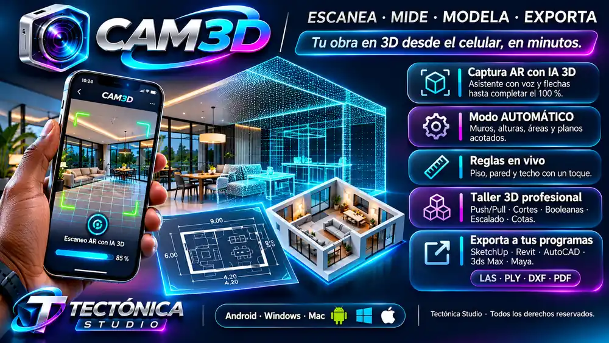

<p align="center">
  
</p>

<h1 align="center">CAM3D</h1>
<p align="center"><b>Escanea · Mide · Modela · Exporta</b><br>Tu obra en 3D desde el celular, en minutos.</p>

<p align="center">
  <a href="https://github.com/tectonicastudio-rd/cam3d/releases/download/v3.0/CAM3D_TectonicaStudio_V3.0.apk"></a>
  <a href="https://github.com/tectonicastudio-rd/cam3d/releases/download/v3.0-escritorio/CAM3D_TectonicaStudio_V3.0_Windows_Instalador.exe"></a>
  <a href="https://github.com/tectonicastudio-rd/cam3d/releases/download/v3.0-escritorio/CAM3D_TectonicaStudio_V3.0_Mac_Instalador.dmg"></a>
  <a href="https://tectonicastudio-rd.github.io/cam3d/"></a>
</p>

<p align="center">
  
  
  
</p>

---

## ¿Qué es CAM3D?

**CAM3D** es el primer software de **escaneo 3D de obra** de **Tectónica Studio**. Con la cámara del teléfono y realidad aumentada (ARCore), captura un espacio real, reconstruye automáticamente muros, alturas y áreas, y entrega planos acotados y modelos 3D listos para los programas que usan arquitectos, ingenieros, diseñadores y constructores.

## Funciones principales

| | Función | Qué hace |
|---|---|---|
| 🤖 | **Captura AR con IA 3D** | Un asistente con voz y flechas te guía (izquierda, derecha, arriba, abajo) hasta capturar el espacio al 100 %. |
| ⚙️ | **Modo AUTOMÁTICO** | Reconstruye muros, alturas, áreas y planos acotados sin dibujar. |
| 📏 | **Reglas en vivo** | Reconoce piso, pared y techo; confírmalos con un toque. Medición con cinta en tiempo real. |
| 🧊 | **Taller 3D profesional** | Cubos, cilindros, hexágonos, push/pull, cortes, booleanas (unir, sustraer, intersectar), mover/rotar/escalar por ejes y cotas. |
| 📐 | **Escala y cotas automáticas** | Calibración por medida conocida y acotado automático de todos los muros. |
| 📤 | **Exporta a tus programas** | SketchUp · Revit · AutoCAD · 3ds Max · Maya — DXF, PDF, SVG, OBJ, STL, DAE, CSV · Nubes LAS, PLY, PTS, XYZ. |
| 💬 | **Chat IA** | Pregunta por cantidades de materiales, áreas, pintura, cerámica o un resumen para el cliente. |

## Descargas

| Plataforma | Archivo | Notas |
|---|---|---|
| 📱 Android 7.0+ | [CAM3D_TectonicaStudio_V3.0.apk](https://github.com/tectonicastudio-rd/cam3d/releases/download/v3.0/CAM3D_TectonicaStudio_V3.0.apk) | App local con cámara AR (ARCore). |
| 🪟 Windows 10/11 | [CAM3D_TectonicaStudio_V3.0_Windows_Instalador.exe](https://github.com/tectonicastudio-rd/cam3d/releases/download/v3.0-escritorio/CAM3D_TectonicaStudio_V3.0_Windows_Instalador.exe) | Modelado, planos y exportación. |
| 🍎 macOS (Intel y Apple Silicon) | [CAM3D_TectonicaStudio_V3.0_Mac_Instalador.dmg](https://github.com/tectonicastudio-rd/cam3d/releases/download/v3.0-escritorio/CAM3D_TectonicaStudio_V3.0_Mac_Instalador.dmg) | Modelado, planos y exportación. |
| 🌐 Navegador | [tectonicastudio-rd.github.io/cam3d](https://tectonicastudio-rd.github.io/cam3d/) | Versión web. |
| 🍏 iPhone (iOS 15+) | [CAM3D_TectonicaStudio_V3.0_iPhone.ipa](https://github.com/tectonicastudio-rd/cam3d/releases/download/v3.0-iphone/CAM3D_TectonicaStudio_V3.0_iPhone.ipa) | App local con cámara AR (ARKit). Se instala desde la PC con Sideloadly — ver [instrucciones](https://github.com/tectonicastudio-rd/cam3d/releases/download/v3.0-iphone/INSTALAR_EN_IPHONE.txt). |

> La captura con cámara AR se hace en Android o iPhone. En Windows y Mac abre el **Respaldo .cam3d** para modelar, acotar y exportar.

## Cómo se usa

1. **Captura** — abre *IA 3D* o *AUTOMÁTICO*, apunta al piso y sigue las flechas hasta el 100 %.
2. **Revisa** — CAM3D reconstruye el espacio: área, perímetro, alto y muros.
3. **Modela** — ajusta en el *Taller 3D* con push/pull, booleanas y cotas.
4. **Exporta** — envía el plano o el modelo a SketchUp, Revit, AutoCAD, 3ds Max o Maya.

## Instalación

- **Android:** abre el APK y permite «Instalar apps desconocidas». Al primer inicio acepta Cámara y Micrófono.
- **Windows:** si aparece «Windows protegió tu PC», toca «Más información» › «Ejecutar de todas formas».
- **Mac:** la primera vez, clic derecho sobre CAM3D › «Abrir» (o Ajustes del Sistema › Privacidad y seguridad › «Abrir igualmente»).

## Requisitos

| | Mínimo |
|---|---|
| Android | 7.0, compatible con ARCore («Servicios de Google Play para RA») |
| Windows | 10 / 11 de 64 bits |
| macOS | 11 o superior |

## Estructura del repositorio

```
├── index.html, app.js, core.js, modeler.js, ai.js, native.js   ← aplicación
├── desktop/                     ← versión de escritorio (Windows y Mac)
├── android_src.bundle           ← código de la app de Android
├── assets/                      ← imágenes y banner
├── .github/workflows/           ← compilación automática de instaladores
├── CHANGELOG.md                 ← historial de versiones
└── LICENSE.md                   ← derechos reservados
```

## Historial

Consulta el [CHANGELOG](CHANGELOG.md).

---

<p align="center"><br><b>Tectónica Studio</b><br>© 2026 Tectónica Studio · Todos los derechos reservados</p>

